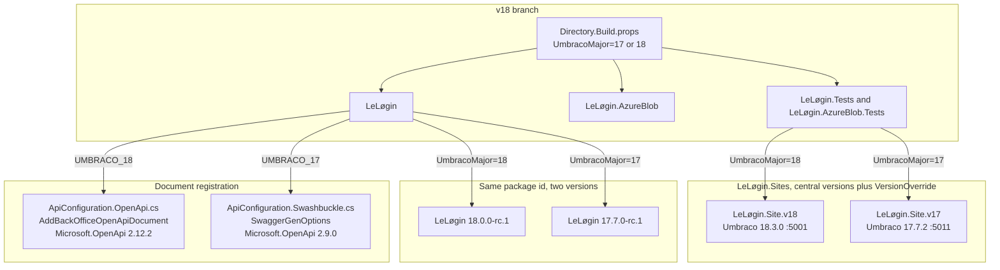

# Dual Version Support Plan: Umbraco v17 & v18 in Parallel

## Status

Revised 3 November 2026, after checking this repository, `LeLøgin.Sites`, NuGet, and the Umbraco tags `release-17.7.2`, `release-17.8.0`, `release-18.1.0`, `release-18.2.1`, and `release-18.3.0`. The v17 track compiles against and is proved on Umbraco **17.7.2**.

Proposed. One branch builds a Le Løgin package for Umbraco 17 and one for Umbraco 18. The two packages share the product code. They do not share a compile-time Umbraco reference.

## 1. Verified baseline

| Item | What is true today |
| --- | --- |
| Branch | `v18` at `8147b11`, package version `18.0.0-rc.1`. `main` (`0e10239`) is a direct ancestor and is already an Umbraco 18 tree (package `18.0.0`, `Umbraco.Cms.Api.Management` `18.0.0`). `origin/main` is 7 commits behind local `main`. |
| v17 line | There is no v17 branch. The last v17 package reference is the parent of `6129a91` (`feat: upgrade to Umbraco 18`). That commit is older than the login-shell, render-token, and database-readiness work. |
| Compile references | `LeLøgin.csproj` references Umbraco `18.0.0`, `Microsoft.OpenApi` `2.11.0`, `SixLabors.ImageSharp` `3.1.12`, and `System.Security.Cryptography.Xml` `10.0.11`, all with `PrivateAssets="all"`. |
| Test host | `LeLøgin.Sites` holds two hosts. `LeLøgin.Site.v18` is the existing site, retargeted to Umbraco `18.3.0`, on `https://localhost:5001`, with its original SQLite database. `LeLøgin.Site.v17` is a new host on Umbraco `17.7.2` and `https://localhost:5011`, with its own database. Central package management stays at the site root; each project sets `VersionOverride` from `$(UmbracoPackageVersion)`. `LeLøgin.Tests` references only the site selected by `$(UmbracoMajor)`. |
| Azure Blob | `LeLøgin.AzureBlob.csproj` and `LeLøgin.AzureBlob.Tests.csproj` pin `Umbraco.StorageProviders.AzureBlob` `18.0.0`. |
| Login shell | `umbraco/UmbracoLogin/Index.cshtml` matches `release-17.7.2` and `release-18.3.0` apart from the Le Løgin insertions (render token, greeting module, `login.js` replacement). Those two upstream files are byte-identical. |
| Client | `@umbraco-cms/backoffice` is a devDependency at `18.3.0` and is external at runtime. `tsc` and the unit tests also pass against `17.7.2`. `Client/scripts/sync-package-version.mjs` writes only `Client/public/umbraco-package.json`. Codegen is aimed at `/umbraco/openapi/le-løgin-api-v1.json`. |
| Target framework | Umbraco 17 and Umbraco 18 both target `net10.0`. |

## 2. Compile floors

Checked against NuGet and [Umbraco releases](https://releases.umbraco.com/?repo=Umbraco-CMS) on 3 November 2026.

| Track | Umbraco floor | Released | Why this floor |
| --- | --- | --- | --- |
| 18 | `18.3.0` | 29 October 2026 | Current stable 18. Supersedes `18.2.1`. |
| 17 | `17.7.2` | 27 October 2026 | Oldest 17 host this package claims. The proof site runs this version. |

`17.8.0` is a newer LTS patch, and `17.9.0-rc`, `17.10.0-rc`, `18.4.0-rc`, and `19.0.0-beta1` exist. None of them is the compile target. Compiling the v17 track against `17.8.0` would allow ImageSharp 3.2 APIs that a 17.7.2 host does not have. Newer 17 patches are expected to load the 17.7.2 build, because the host supplies the assemblies, but a green 17.8 site does not prove 17.7.2. Umbraco 19 is `net11.0` and is recorded separately in [umbraco-v19-compatibility.md](umbraco-v19-compatibility.md).

These floors are compile-time references. They are not the Le Løgin package version.

`release-17.7.2` and `release-18.3.0` pin different security closures. The 17 host still ships `System.Security.Cryptography.Xml` `10.0.10`, which is inside `GHSA-7hqp-7c5m-4vq6`. Both tracks compile against the patched `10.0.13`. The reference is `PrivateAssets="all"`, so a 17.7.2 host keeps its own copy at runtime.

| Package | 17.7.2 track | 18.3.0 track |
| --- | --- | --- |
| `System.Security.Cryptography.Xml` | `10.0.13` | `10.0.13` |
| `MessagePack` | `3.1.11` | `3.1.11` |

`SixLabors.ImageSharp` is not a direct reference. ImageSharp 3.2.0 rejects a Release build that references it directly unless a Six Labors license key is present, and that check does not apply to a transitive reference. `Umbraco.Cms.Imaging.ImageSharp` at the track's Umbraco version supplies ImageSharp and ImageSharp.Web. On the 18 track that is ImageSharp 3.2.0. `Umbraco.StorageProviders.AzureBlob` 18.0.0 still resolves MessagePack 3.1.7 (`GHSA-qhrr-8q5h-9q3h`, patched in 3.1.9); both tracks pin 3.1.11, which is what Umbraco 18.3.0 uses. 17.7.2's own pin is 3.1.8 and is still inside the advisory.

`Umbraco.StorageProviders.AzureBlob` splits as well. The current 17 release is `17.1.0` (25 June 2026, Umbraco range `[17.0.0, 18.0.0)`), which includes a 17.7.2 host. The 18 release remains `18.0.0`.

## 3. Decisions

1. **Build the dual track on `v18`.** Do not snapshot `main` as `backup/v17-pre-dual-track`. That commit is already Umbraco 18, and it lacks the `v18` stabilisations. Promoting `v18` onto `main` is a separate publish step and needs an explicit git go-ahead. `origin/main` is behind local `main`, so a fast-forward is not a one-remote-update.
2. **One branch, one MSBuild switch.** `UmbracoMajor` is `18` or `17`, default `18`. It selects references, compile constants, output directories, and the Le Løgin package version. It does not select the target framework.
3. **Le Løgin keeps its own versions.** `UmbracoMajor=18` packs `18.0.0-rc.1` (then `18.0.0` when that release is cut). `UmbracoMajor=17` packs `17.7.0-rc.1`. The `17.7` minor marks the Umbraco 17.7 line this build is for. The Umbraco patch `17.7.2` is not copied onto the package. Later product releases increment Le Løgin's own patch or minor on each line. Both packages keep the id `LeLøgin`. The major tells a consumer which Umbraco line the build was compiled for, which matters because Umbraco stays `PrivateAssets="all"` and is not a NuGet dependency of the package.
4. **Two site directories, one site repository.** `LeLøgin.Sites` already uses `Directory.Packages.props` with `ManagePackageVersionsCentrally`. A second site in that repo cannot take a different `Umbraco.Cms` version from a second props file. Each site sets `VersionOverride` on `Umbraco.Cms` and `Umbraco.Cms.DevelopmentMode.Backoffice`. Give the v17 site its own directory, port, and SQLite file. Suggested ports: v18 stays `https://localhost:5001`; v17 uses `https://localhost:5011`.
5. **One login shell.** No Razor conditional. See §5.
6. **Split OpenAPI registration, not the schema writer, until a compile forces it.** See §6.

## 4. Shape



### 4.1 `Directory.Build.props`

Define:

- `$(UmbracoMajor)`, default `18`. Fail the build on any other value.
- Constants `UMBRACO_18` or `UMBRACO_17`.
- `$(UmbracoPackageVersion)`: `18.3.0` or `17.7.2`.
- `$(UmbracoBlobPackageVersion)`: `18.0.0` or `17.1.0`.
- `$(OpenApiPackageVersion)`: `2.12.2` or `2.9.0`.
- `$(LeLoginPackageVersion)`: `18.0.0-rc.1` or `17.7.0-rc.1`. This becomes `$(Version)` on the packable projects. It is not `$(UmbracoPackageVersion)`.
- `$(CryptographyXmlPackageVersion)`: `10.0.13` on both tracks.
- `$(MessagePackPackageVersion)`: `3.1.11` on both tracks.
- Intermediate and output paths `obj/v$(UmbracoMajor)/` and `bin/v$(UmbracoMajor)/`, so a track switch does not reuse the other track's assemblies.
- Package output under `artifacts/v$(UmbracoMajor)/`.

`LeLøgin.csproj`, `LeLøgin.AzureBlob.csproj`, `LeLøgin.AzureBlob.Tests.csproj`, and both site projects consume these properties. `LeLøgin.Tests.csproj` conditionally references `LeLøgin.Site.v18` or `LeLøgin.Site.v17`, never both. Referencing both loads two Umbraco majors into one test process.

## 5. Login shell

Verified by diffing upstream `src/Umbraco.Cms.StaticAssets/umbraco/UmbracoLogin/Index.cshtml`:

- `release-17.7.2`, `release-17.8.0`, `release-18.1.0`, `release-18.2.1`, and `release-18.3.0` are byte-identical.
- All of them inject `ICspNonceService` and call the four-argument `BackOfficeImportMapScriptAsync`.
- Le Løgin's copy adds the render token, the greeting-module URL, and the `login.js` replacement. Those insertions use `IFileVersionProvider` and extra route values. They do not depend on an 18-only helper.

Keep a single `umbraco/UmbracoLogin/Index.cshtml`. Do not add a 17 view or a Razor `#if`. On every floor bump, diff the file against `release-17.7.2` and `release-18.3.0` (or their successors). The view comment cites those two floors.

`MapToApi`, `BackOfficeRoute`, and the graphics route names used by the shell are present on the 17.7.2 management assemblies. `FreshInstallStartupTests` already requests the three graphics paths; run that suite on both sites after the shell is packed.

## 6. OpenAPI

Umbraco 18 did not move from OpenAPI v1 to OpenAPI v2. Umbraco 17.7.2 already uses `Microsoft.OpenApi` 2.x via Swashbuckle 10. The split is the generator, the registration API, and the OpenAPI package pin.

| | Umbraco 17.7.2 | Umbraco 18.3.0 |
| --- | --- | --- |
| Generator | `Swashbuckle.AspNetCore` `10.2.3` | `Microsoft.AspNetCore.OpenApi` `10.0.12`, plus `Swashbuckle.AspNetCore.SwaggerUI` `10.2.3` |
| `Microsoft.OpenApi` | **`2.9.0`, held.** Umbraco's props say `2.10.0+` rewrites OpenAPI 3.0 nullability (`enum: [null]`, `oneOf` refs dropping `nullable`) and breaks client generation. Tracked as [OpenAPI.NET #2967](https://github.com/microsoft/OpenAPI.NET/issues/2967). | `2.12.2` |
| Registration | `ConfigureOptions` of `SwaggerGenOptions`, `SwaggerDoc`, `BackOfficeSecurityRequirementsOperationFilterBase` | `IUmbracoBuilder.AddBackOfficeOpenApiDocument`, `WithBackOfficeAuthentication`, `OpenApiOptions.AddSchemaTransformer` |
| Document URL | `/umbraco/swagger/le-løgin-api-v1/swagger.json` | `/umbraco/openapi/le-løgin-api-v1.json` |

`LeLøgin.csproj` currently pins `Microsoft.OpenApi` `2.11.0`, which matches Umbraco 18.1.0, is above the 17.7.2 hold, and is below 18.3.0. Because the reference is `PrivateAssets="all"`, the host's copy is the one that runs. Compiling the 17 track against `2.11.0` or `2.12.2` can miss methods on a 17.7.2 host, and it is the version Umbraco refuses to generate documents with. Pin each track to its host.

### 6.1 Code layout

`Core/Api/ApiConfiguration.cs` currently does two jobs:

- registration, which is 18-only (`AddBackOfficeOpenApiDocument`, `AddSchemaTransformer`)
- `ApplySchemaOverride`, which mutates `Microsoft.OpenApi.OpenApiSchema` and is what `ApiConfigurationSchemaTests` calls

Keep `ApplySchemaOverride` in a shared file. Both generators speak `Microsoft.OpenApi` 2.x (`JsonSchemaType`, `OneOf`, `JsonNode`). The 17 adapter is a Swashbuckle `ISchemaFilter` that casts `IOpenApiSchema` to `OpenApiSchema` and calls the shared method. Compile that shared file against `2.9.0` and against `2.12.2`. Split the writer only if one of those pins rejects the current method bodies.

Registration becomes two compile units, selected from `LeLøgin.csproj`:

- `Core/Api/ApiConfiguration.OpenApi.cs` when `UMBRACO_18` is defined. Direct `Swashbuckle.AspNetCore` reference is absent.
- `Core/Api/ApiConfiguration.Swashbuckle.cs` when `UMBRACO_17` is defined. Direct `Swashbuckle.AspNetCore` `10.2.3` reference, `PrivateAssets="all"`.

Both expose:

```csharp
public static IUmbracoBuilder AddLeLøginOpenApiDocument(this IUmbracoBuilder builder)
```

`LoginScreenComposer` and `ApiSecurityTests` keep calling that method with no conditional. Controllers keep `[MapToApi("le-løgin-api-v1")]`, which 17.7.2's `BackOfficeSecurityRequirementsOperationFilterBase` already selects on.

### 6.2 Generated client

`Client/package.json` generates from `https://localhost:5001/umbraco/openapi/le-løgin-api-v1.json`. That path does not exist on Umbraco 17. Generate the checked-in client from the Umbraco 18 document only. One client ships in both packages.

The two documents describe the same JSON. Each generator spells it differently, and the checked-in types already follow the 18 spelling (`number | string`, `null | T`). Regenerating from the 17 document would narrow those types. Rewriting one document into the other's dialect is not the goal.

Compare the shared contract after generating both documents:

- Same paths and property names.
- Same enum wire values.
- Same condition-value `oneOf` of string and int32.

Leave these generator spellings out of the comparison:

- Nullability: 17 uses `nullable: true`; 18 uses `type` arrays that include `null`, and `oneOf` of `null` plus a `$ref`.
- Numbers: 18 adds `string` and a numeric `pattern` beside `integer` or `number`.
- 17 sets `additionalProperties: false`. 18 omits it.
- `required` membership. 17 lists the non-nullable properties. 18 also lists nullable properties, because the generator treats a property that is always present in the payload as required. 17 also emits some `minLength` values.
- 17 publishes an unreferenced `LoginRuleConditionValue` wrapper. The `values` array already carries the shared `oneOf`.
- 18 names `IFormFile` for the upload body. 17 inlines the binary string.

Update the checked-in client only when that shared contract changes.

## 7. Client bundle

Backoffice modules are Vite externals, so the browser loads the host's copy. Type-checking still uses the devDependency.

- Point the 18 typecheck at `@umbraco-cms/backoffice` `18.3.0` and the 17 typecheck at `17.7.2`. Both are published. A green build against `18.0.0` or `17.8.0` says nothing about a 17.7.2 host.
- Run `pnpm test:unit` and `tsc` once per pin. One bundle ships if both pass. A type error on 17 is a real split; do not paper over it with a cast.
- `sync-package-version.mjs` must stop rewriting `Client/package.json`. That file's `version` is not what Umbraco loads, and rewriting it dirties the tree on every track switch. Write the Le Løgin version only into the manifest that is packed (`public/umbraco-package.json`, then the `wwwroot` build output). Leave the `@umbraco-cms/backoffice` devDependency to the typecheck step.

## 8. Implementation steps

### Phase 1: Props and references

1. Add root `Directory.Build.props` as in §4.1.
2. Move `Version`, Umbraco references, OpenAPI, ImageSharp, and Cryptography.Xml in `LeLøgin.csproj` onto those properties.
3. Move the Azure Blob reference in `LeLøgin.AzureBlob.csproj` and `LeLøgin.AzureBlob.Tests.csproj` onto `$(UmbracoBlobPackageVersion)`.
4. Confirm `dotnet build -p:UmbracoMajor=18` before any 17-only file exists. This is the current product on the new floors.

### Phase 2: OpenAPI bridge

1. Keep `ApplySchemaOverride` shared. Add a failing 17-track test only where the Swashbuckle filter's cast or document shape is the behaviour under test.
2. Move 18 registration into `ApiConfiguration.OpenApi.cs`.
3. Add `ApiConfiguration.Swashbuckle.cs` and the conditional `Compile` items.
4. Build both tracks with `TreatWarningsAsErrors`.

### Phase 3: Sites

1. In `LeLøgin.Sites`, add `LeLøgin.Site.v18` at Umbraco `18.3.0` (the existing site, retargeted) and `LeLøgin.Site.v17` at `17.7.2`.
2. Use `VersionOverride` so central package management can hold one default while the two projects disagree.
3. Separate SQLite databases, ports `5001` and `5011`, and `umbraco/Data` directories.
4. Point `LeLøgin.Tests.csproj` at the site selected by `$(UmbracoMajor)`.

### Phase 4: Client

1. Narrow `sync-package-version.mjs` to the packed manifest.
2. Typecheck and run unit tests against backoffice `18.3.0` and `17.7.2`.
3. Generate both OpenAPI documents. `Installed_Site_Serves_The_Le_Løgin_OpenApi_Document` compares each one with `LeLøgin.Tests/Api/openapi-shared-contract.json` (§6.2). Update that fixture and the checked-in client, from the 18 document, only when the shared contract changes.

### Phase 5: Proof

Run each track in its own process. One `dotnet test` invocation cannot host both majors.

```bash
dotnet test -p:UmbracoMajor=18
dotnet test -p:UmbracoMajor=17
dotnet pack -c Release -p:UmbracoMajor=18
dotnet pack -c Release -p:UmbracoMajor=17
```

`FreshInstallStartupTests` runs inside those `dotnet test` calls, against the site that track references. Also boot each site, sign in, and open the overview.

## 9. Checklist

- [x] `dotnet build -p:UmbracoMajor=18` and `-p:UmbracoMajor=17` are clean with `TreatWarningsAsErrors`.
- [x] 18 track references Umbraco `18.3.0`, OpenAPI `2.12.2`, Cryptography.Xml `10.0.13`, MessagePack `3.1.11`, Azure Blob `18.0.0`. ImageSharp 3.2.0 is transitive through `Umbraco.Cms.Imaging.ImageSharp`, not a direct reference.
- [x] 17 track references Umbraco `17.7.2`, OpenAPI `2.9.0`, Swashbuckle `10.2.3`, Cryptography.Xml `10.0.13`, MessagePack `3.1.11`, Azure Blob `17.1.0`. The proof site is 17.7.2, not 17.8.0. ImageSharp stays the host's 3.1.12; its audit is suppressed because a direct 3.2 reference requires a Six Labors licence.
- [x] Packed versions are Le Løgin `18.0.0-rc.1` and `17.7.0-rc.1`, not `18.3.0` and `17.7.2`.
- [x] `bin/` and `obj/` are per track, and switching tracks does not modify `Client/package.json`.
- [x] `ArchitectureRuleTests` pass on both tracks.
- [x] `ApiConfigurationSchemaTests` pass on both tracks against the shared schema writer.
- [x] The two OpenAPI documents agree on paths, property names, enum wire values, and the condition-value `oneOf`. The checked-in client is generated from the 18 document. Generator spelling stays out of that comparison, as listed in §6.2.
- [x] Login shell diff against `release-17.7.2` and `release-18.3.0` shows only the Le Løgin insertions.
- [x] Both sites reach the installer or login screen, serve the three graphics paths, authenticate, and render the overview.
- [x] Both `.nupkg` files contain the static assets and do not flow Umbraco, OpenAPI, Swashbuckle, or ImageSharp as dependencies.
- [x] Client unit tests and `tsc` pass with `@umbraco-cms/backoffice` `18.3.0` and `17.7.2`.
